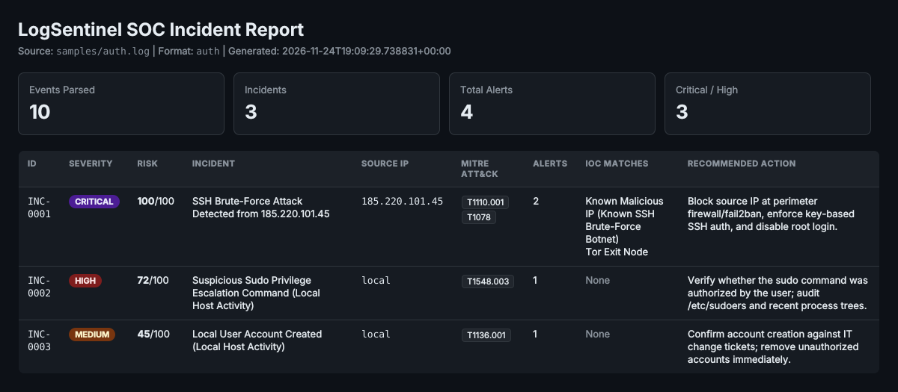

<div align="center">

# 🛡️ LogSentinel

**Turn thousands of confusing computer log lines into a short, prioritized list of security incidents.**

*Python SOC log analyzer · Sigma-style detection rules · MITRE ATT&CK mapping · IOC enrichment*

[](https://github.com/faizi-cybsec/LogSentinel/actions/workflows/ci.yml)
[](https://github.com/faizi-cybsec/LogSentinel/releases)
[](LICENSE)
[](https://www.python.org/downloads/)
[-brightgreen.svg)](pyproject.toml)

[](https://attack.mitre.org/)
[](#try-it-in-2-minutes)
[](src/logsentinel/py.typed)
[](CONTRIBUTING.md)

[](https://github.com/faizi-cybsec/LogSentinel/commits/main)
[](https://github.com/faizi-cybsec/LogSentinel/issues)
[](https://github.com/faizi-cybsec/LogSentinel/stargazers)
[](https://github.com/faizi-cybsec/LogSentinel)

</div>

---

## What is this?

Every server, website, and cloud account keeps a diary of everything that happens to it. These diaries are called **logs**, and they are long, messy, and hard to read.

**LogSentinel reads those logs for you.** It spots signs of an attack (for example, someone repeatedly guessing a password), groups related warnings together, scores how serious each problem is from 0 to 100, and tells you what to do about it.

It was built for **security analysts and students**, but the report it produces is written so that anyone can follow it.

### What it does

- **Reads three kinds of logs:** Linux login logs, website access logs, and cloud account activity logs. It detects the format automatically.
- **Detects 9 common attack patterns** such as password guessing, website hacking attempts, and suspicious admin activity.
- **Checks against known bad actors:** it flags activity from known malicious IP addresses and hacking tools.
- **Prioritizes:** related warnings are merged into a single *incident* with a risk score, so you look at what matters first.
- **Gives you a report** in your terminal, as a web page (HTML), or as a data file (JSON or CSV).
- **Needs nothing extra:** no accounts, no internet connection, and no extra libraries.

---

## See it in action

Running LogSentinel on the included sample log:

```text
========================================================================
  LOGSENTINEL - SOC THREAT TRIAGE & DETECTION REPORT
========================================================================
  Source File     : samples/auth.log
  Detected Format : auth
  Events Parsed   : 10/10 lines (skipped: 0)
  Rules Loaded    : 9
  Alerts / Incid. : 4 alerts -> 3 incidents
  Analysis Time   : 30.8 ms

  Severity Breakdown: CRITICAL=2  HIGH=1  MEDIUM=1  LOW=0

  PRIORITIZED INCIDENTS
  --------------------------------------------------------------------
  INC-0001 [CRITICAL] Risk=100/100 | SSH Brute-Force Attack Detected from 185.220.101.45
    Window   : 2026-11-24T23:04:12+00:00 -> 2026-11-24T23:04:29+00:00 (2 alerts)
    MITRE    : T1110.001, T1078
    Users    : ubuntu
    IOC Hits : Known Malicious IP (Known SSH Brute-Force Botnet), Tor Exit Node
    Response : Block source IP at perimeter firewall/fail2ban, enforce key-based SSH auth, and disable root login.
```

And the web report it can generate:



---

## Try it in 2 minutes

**You need:** [Python 3.10 or newer](https://www.python.org/downloads/). To check, open a terminal and run `python --version`.

**1. Download and install**

```bash
git clone https://github.com/faizi-cybsec/LogSentinel.git
cd LogSentinel
pip install -e .
```

**2. Analyze the sample log and create a report**

```bash
logsentinel analyze samples/auth.log --html-out reports/auth_report.html
```

You will see the summary in your terminal, and a report file is saved at `reports/auth_report.html`.

**3. Open the report in your browser**

- Windows: `start reports\auth_report.html`
- macOS: `open reports/auth_report.html`
- Linux: `xdg-open reports/auth_report.html`

Two more sample logs are included: `samples/web_access.log` and `samples/cloud_events.jsonl`. To use your own logs, replace the file path.

---

## What attacks does it catch?

| What it looks for | Plain-English meaning | Severity |
| :--- | :--- | :--- |
| SSH brute-force | Someone is rapidly guessing passwords to log in | HIGH |
| Account compromise after brute-force | Many failed logins, then a successful one: the attacker probably got in | CRITICAL |
| Suspicious `sudo` command | Someone is using admin powers in a risky way | HIGH |
| New local user created | A new account appeared, which attackers use to stay hidden | MEDIUM |
| SQL injection probe | Someone is trying to trick a website's database | HIGH |
| Path traversal attempt | Someone is trying to read files they should not be able to reach | HIGH |
| Web scanner burst | An automated tool is rapidly probing a website for weak spots | MEDIUM |
| Cloud access key created | A new key to a cloud account was made, which could be a backdoor | MEDIUM |
| Cloud root login without MFA | The most powerful cloud account was used without a second security step | CRITICAL |

<details>
<summary><b>Technical view: rule IDs and MITRE ATT&CK mapping</b></summary>

<br>

| Rule ID | Title | Severity | Type | MITRE ATT&CK |
| :--- | :--- | :--- | :--- | :--- |
| `LS-AUTH-001` | SSH Brute-Force Attack Detected | `HIGH` | `threshold` | `T1110.001` (Credential Access) |
| `LS-AUTH-002` | Potential SSH Account Compromise After Brute-Force | `CRITICAL` | `sequence` | `T1078` (Initial Access) |
| `LS-PRIV-001` | Suspicious Sudo Privilege Escalation Command | `HIGH` | `match` | `T1548.003` (Privilege Escalation) |
| `LS-PRIV-002` | Local User Account Created | `MEDIUM` | `match` | `T1136.001` (Persistence) |
| `LS-WEB-001` | SQL Injection Probe Detected in HTTP Request | `HIGH` | `match` | `T1190` (Initial Access) |
| `LS-WEB-002` | Path Traversal / Local File Inclusion Attempt | `HIGH` | `match` | `T1190` (Initial Access) |
| `LS-WEB-003` | Automated Web Vulnerability Scanner / Recon Burst | `MEDIUM` | `threshold` | `T1595.002` (Reconnaissance) |
| `LS-CLOUD-001` | Cloud IAM Access Key Created | `MEDIUM` | `match` | `T1098.001` (Persistence) |
| `LS-CLOUD-002` | Cloud Root Account Login Without MFA | `CRITICAL` | `match` | `T1078.004` (Initial Access) |

Rule types:
- `match`: flags a single suspicious event.
- `threshold`: flags too many events within a short time window.
- `sequence`: flags a multi-step pattern, such as failures followed by a success.

</details>

---

## How it works

```text
  Your log file
       │
       ▼
  1. Read & understand   (detects the log format and cleans up each line)
       │
       ▼
  2. Detect              (checks every event against the attack rules)
       │
       ▼
  3. Enrich              (compares against known malicious IPs and hacking tools)
       │
       ▼
  4. Prioritize          (merges related alerts into incidents, scores 0-100)
       │
       ▼
  5. Report              (terminal, HTML, JSON, or CSV)
```

---

## Plain-English glossary

| Term | Meaning |
| :--- | :--- |
| **Log** | An automatic record of events on a computer, website, or cloud account |
| **SOC** | Security Operations Center: the team that watches for attacks |
| **Brute-force** | Guessing passwords over and over until one works |
| **IOC** | Indicator of Compromise: a known "fingerprint" of an attacker, such as a bad IP address |
| **MITRE ATT&CK** | A public catalog of attacker techniques, used as a shared vocabulary in security |
| **Alert vs. incident** | An alert is one warning. An incident is a group of related alerts about the same attacker |
| **SIEM** | A large security system that collects logs from many sources. LogSentinel is a small, focused tool in the same spirit |

---

## Advanced usage

<details>
<summary><b>Command-line options</b></summary>

<br>

| Command / Flag | Description |
| :--- | :--- |
| `logsentinel analyze <file>` | Parse, detect, enrich, and triage a log file |
| `--format {auto,auth,web,jsonl}` | Override automatic log format detection |
| `--rules-dir <dir>` | Path to custom JSON detection rules directory |
| `--ioc-feed <file>` | Path to custom JSON threat-intel IOC feed |
| `--min-severity {LOW,MEDIUM,HIGH,CRITICAL}` | Hide alerts below a minimum severity |
| `--json-out <file>` | Export a JSON report (for SIEM/SOAR tools) |
| `--csv-out <file>` | Export a flat CSV alert table |
| `--html-out <file>` | Export a self-contained dark-mode HTML report |
| `--fail-on-high` | Exit with code `2` if `HIGH` or `CRITICAL` incidents are found (useful in CI/CD pipelines) |
| `logsentinel list-rules` | Print all loaded rules and their MITRE ATT&CK mappings |
| `logsentinel validate-rules` | Check that rule files are valid |

</details>

<details>
<summary><b>Run without installing</b></summary>

<br>

macOS / Linux:

```bash
PYTHONPATH=src python -m logsentinel analyze samples/auth.log
```

Windows PowerShell:

```powershell
$env:PYTHONPATH="src"; python -m logsentinel analyze samples/auth.log
```

</details>

<details>
<summary><b>Write your own detection rule</b></summary>

<br>

Drop any `.json` file into the `rules/` folder (a single rule or a list of rules). Example `sequence` rule:

```json
{
  "id": "LS-AUTH-002",
  "title": "Potential SSH Account Compromise After Brute-Force",
  "description": "Repeated failed SSH logins followed by a successful login from the same source IP.",
  "severity": "CRITICAL",
  "mitre_tactic": "Initial Access",
  "mitre_technique": "T1078",
  "rule_type": "sequence",
  "formats": ["auth"],
  "group_by": "source_ip",
  "window_seconds": 300,
  "min_first_count": 3,
  "first_match": { "action": ["ssh_login", "ssh_invalid_user"], "outcome": "failure" },
  "then_match": { "action": "ssh_login", "outcome": "success" },
  "remediation": "Immediately isolate host, terminate active SSH sessions, and rotate credentials."
}
```

</details>

<details>
<summary><b>Project structure</b></summary>

<br>

```text
LogSentinel/
├── src/logsentinel/           # The program itself
│   ├── cli.py                 # Command-line interface
│   ├── parsers.py             # Reads the three log formats
│   ├── rules.py               # Loads rules and runs detection
│   ├── threat_intel.py        # Checks against known bad IPs and tools
│   ├── triage.py              # Groups alerts into incidents and scores them
│   ├── reporters.py           # Terminal, JSON, CSV, and HTML output
│   └── models.py              # Shared data structures
├── rules/                     # Attack-detection rules (JSON)
├── feeds/default_iocs.json    # Sample list of known bad IPs and tools
├── samples/                   # Example logs to try
├── tests/                     # Automated tests
├── docs/                      # Screenshot used in this README
├── .github/                   # Automated testing and contribution templates
├── CHANGELOG.md  CONTRIBUTING.md  SECURITY.md  LICENSE
└── pyproject.toml             # Package configuration
```

</details>

<details>
<summary><b>Run the tests</b></summary>

<br>

```bash
python -m unittest discover -s tests -v
```

</details>

---

## Limitations

LogSentinel is a lightweight learning and triage tool, **not a replacement for an enterprise security platform**. Please keep in mind:

- **Log timestamps without a year or timezone.** Classic Linux login logs (`Nov 24 23:10:05`) do not include a year or timezone, so LogSentinel assumes UTC and the current year. Logs from other timezones or past years can produce skewed time windows. Timestamps in ISO-8601 format are handled correctly.
- **Missing cloud timestamps.** A cloud event with no timestamp is stamped with the time of analysis, which can distort time-based rules.
- **Limited Linux log coverage.** It understands SSH logins, `sudo` commands, and new-user events. Other message types are skipped, and the report shows how many lines were skipped.
- **Standard website logs only.** Website logs must use the common Apache/Nginx "Combined" format.
- **False alarms are possible.** Rules match suspicious patterns but cannot confirm that an attack succeeded. For example, your own security team's scanner will trigger the scanner rule.
- **The bad-IP list is a small sample.** `feeds/default_iocs.json` contains demonstration entries. For real use, supply your own regularly updated list.
- **Offline only.** There are no live lookups such as IP geolocation or reputation services.

## Roadmap

- [ ] Windows Event Log support
- [ ] Password-spraying detection
- [ ] Log-clearing / tampering detection
- [ ] Configurable timezone for Linux logs (`--tz`)
- [ ] Custom website log formats
- [ ] MITRE ATT&CK Navigator export

---

## Contributing & Security

- Contributions are welcome. See [CONTRIBUTING.md](CONTRIBUTING.md).
- To report a security issue, see [SECURITY.md](SECURITY.md).
- Released under the [MIT License](LICENSE) by **Faizan Ahmad** ([`@faizi-cybsec`](https://github.com/faizi-cybsec)).
